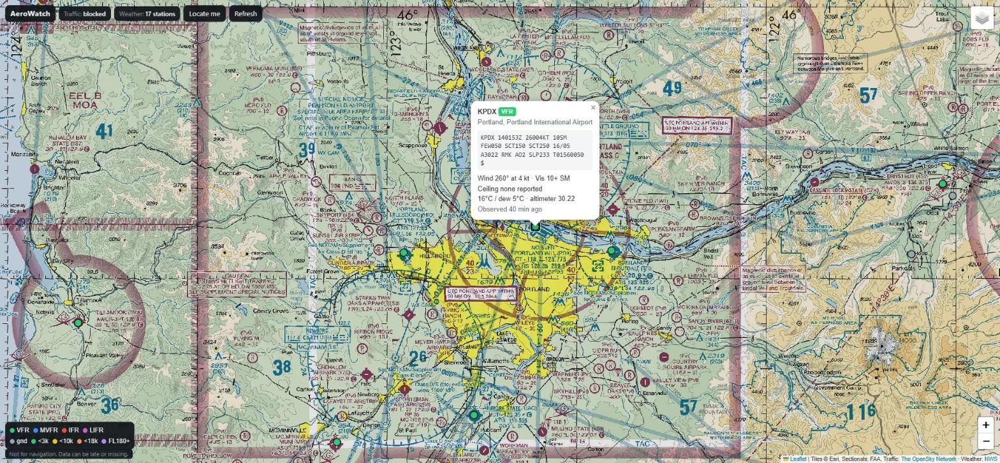

# AeroWatch

I'm a private pilot and wanted one map that shows who's flying nearby, what the weather is doing at the airports around me, and where the airspace is. So this puts it all together: live traffic from OpenSky, current conditions from the National Weather Service, and the FAA's VFR sectional chart.

It's one HTML file. No build step, no framework, just [Leaflet](https://leafletjs.com) for the map. There's a live copy on GitHub Pages, linked in the About section. Weather and the sectional work there, traffic needs the local server (see below).



## What it shows

- **Traffic** from the OpenSky Network, refreshed every 30 seconds. Planes are colored by altitude and point the way they're tracking. Click one for altitude, ground speed, vertical speed and squawk. Anything squawking 7500, 7600 or 7700 turns red and blinks.
- **Weather** at the nearest airports. Each dot is colored by flight category (green VFR, blue MVFR, red IFR, magenta LIFR). Click one for the METAR with wind, visibility, ceiling, temperature and altimeter pulled out of it.
- **VFR sectionals** straight from the FAA's tile server. They're off by default, turn them on with the layers button in the top right. The FAA only publishes them between zoom levels 8 and 12, so the layer disappears if you zoom way out.
- **Your position** if you hit Locate me.

It remembers where you left the map and which layers you had on.

## Running it

Weather and sectionals work anywhere, including the live copy. Traffic is the annoying part. OpenSky doesn't send CORS headers, so browsers won't let a web page on another site call their API. aviationweather.gov, which has every METAR, does the same thing. The way around it is a small Python server that serves the page and makes those requests itself. Download or clone this repo, then in its folder run:

```
python3 serve.py
```

Then open http://localhost:8000. Nothing to install, it only uses the standard library. To use a different port: `python3 serve.py 8080`.

## Limits

- OpenSky's anonymous API has a daily limit, which is why traffic only refreshes every 30 seconds and won't load if you zoom out past about 25 square degrees. If you hit the limit the top bar says "rate limited" and it tries again later.
- Coverage depends on volunteer ADS-B receivers. Planes without ADS-B Out, or anyone low in a valley, can be missing.
- NWS only covers the US, so there's no weather outside it.
- On the live page the METAR text has to come from NWS, which leaves it out for some airports, so those popups show the latest automated reading instead. Running it locally gets every METAR from aviationweather.gov.
- The dot colors come from the newest NWS reading, which is usually a 5-minute ASOS update, so a dot can change before the next METAR comes out.

## Not for navigation

This is a hobby project. The data can be late or missing and nobody checks it. Use real sources for anything that matters: the actual chart, a briefing, ForeFlight.

## Data

- Traffic: [The OpenSky Network](https://opensky-network.org)
- Weather: [api.weather.gov](https://www.weather.gov/documentation/services-web-api) and [aviationweather.gov](https://aviationweather.gov/data/api/)
- Sectionals: FAA Aeronautical Information Services
- Base maps: Esri and OpenStreetMap

## License

The code is MIT licensed, see [LICENSE](LICENSE). The map tiles and data belong to the providers above.
